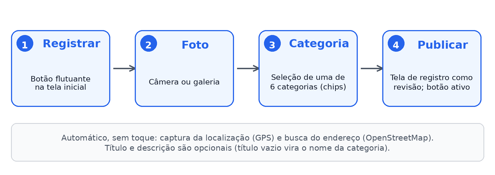
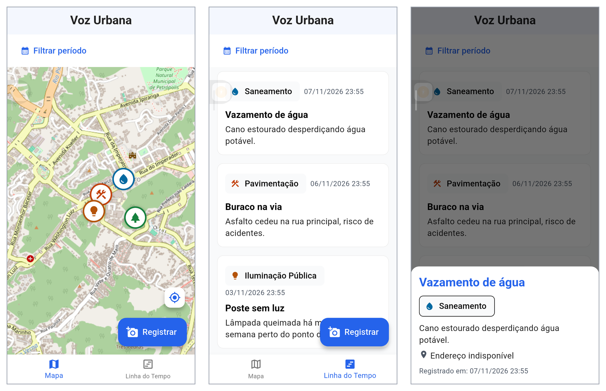
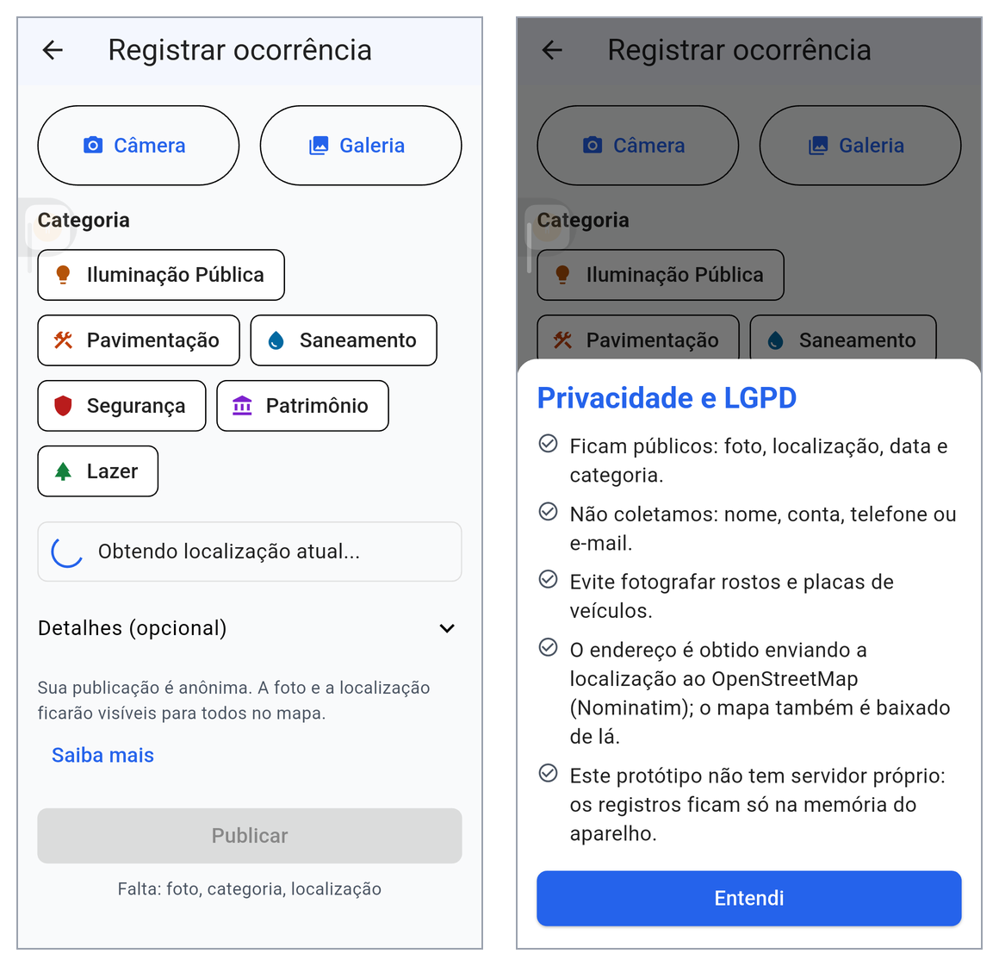
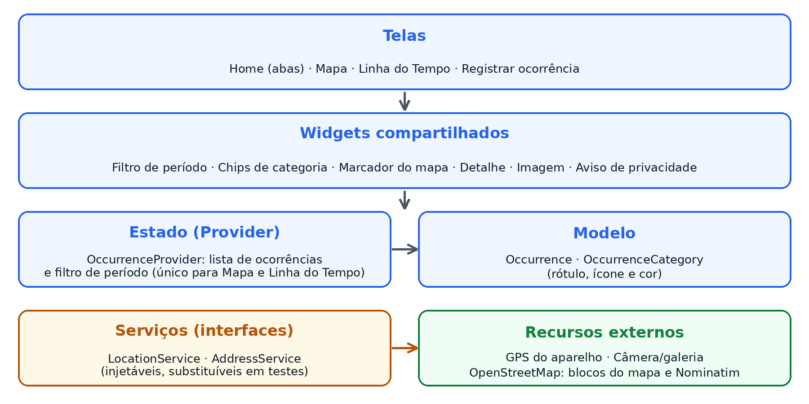
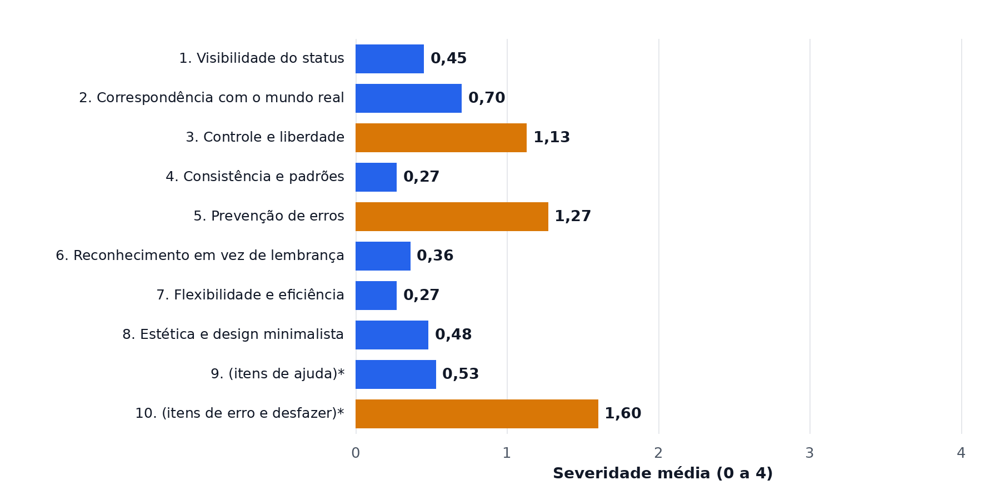

# Voz Urbana: mapeamento colaborativo de infraestrutura urbana e transparência pública

> Relatório do projeto – Projeto de Interação (CEFET/RJ UnED Petrópolis). **Trechos entre asteriscos são provisórios e devem ser trocados pelos dados reais.** Versão formatada para entrega: `relatorio_voz_urbana.docx`.

## RESUMO

Registrar e acompanhar problemas de infraestrutura urbana costuma depender de canais pouco acessíveis e sem histórico público. Este trabalho teve como objetivo projetar e avaliar a interface de um aplicativo móvel colaborativo, o Voz Urbana, que permite ao morador fotografar, categorizar e georreferenciar ocorrências e consultá-las em mapa e em linha do tempo, com filtro por período. Seguiu-se o design centrado no usuário: levantamento de requisitos funcionais, de usabilidade e não funcionais; definição da arquitetura da informação; prototipagem funcional em Flutter para Android; duas rodadas de melhoria orientadas pelas heurísticas de Nielsen; e verificação por 78 testes automatizados e por uso em aparelho real. A avaliação heurística, com dez heurísticas e severidade de 0 a 4, contou com **dois avaliadores** e foi precedida por uma pré-avaliação simulada por inteligência artificial, com cinco personas. O fluxo de registro exige quatro toques. Os maiores problemas foram a impossibilidade de desfazer ou editar um registro (severidade média **2,6**), a prevenção de erros (**2,0**) e a ausência de busca por categoria (**1,6**); a média geral foi de **0,71** em uma escala de 0 a 4. Conclui-se que **os objetivos foram em grande parte alcançados**: a interface é simples e eficiente para registrar e consultar, com limitações já mapeadas (edição, busca, persistência e suporte a iOS) que orientam os próximos passos.

**Palavras-chave:** Design de interação; Avaliação heurística; Usabilidade.

## 1 INTRODUÇÃO

### 1.1 Contexto e problema

Acompanhar a evolução da infraestrutura de um bairro, ou verificar benfeitorias realizadas ao longo do tempo, costuma ser um desafio para quem busca informações locais ou planeja se mudar. Problemas urbanos como buracos, lâmpadas queimadas e vazamentos são, em geral, comunicados por canais que exigem conhecimento prévio do órgão responsável e que não deixam um histórico público consultável por localização e período.

Esse cenário desfavorece tanto o cidadão, que não sabe se o problema já foi reportado ou resolvido, quanto o gestor público, que carece de registros organizados com foto, local e data para priorizar serviços. A questão que orienta este trabalho é: como projetar uma interface móvel simples o bastante para que um morador registre uma ocorrência em poucos passos, em ambiente externo, e que, ao mesmo tempo, permita a qualquer pessoa consultar o histórico do que foi registrado?

### 1.2 Proposta de solução

Este relatório descreve o Voz Urbana, aplicativo móvel colaborativo que permite aos moradores fotografar, categorizar e georreferenciar problemas ou melhorias na cidade. Os registros formam um histórico consultável de duas formas: em um mapa interativo, com marcadores por categoria e miniaturas das fotos, e em uma linha do tempo, ambos com filtro por intervalo de datas.

O trabalho seguiu os conceitos de design de interação e de design centrado no usuário abordados na disciplina Projeto de Interação, priorizando a simplicidade e as necessidades das pessoas antes da tecnologia. O resultado é um protótipo funcional para Android, com dados mantidos apenas em memória, sem servidor próprio, adequado à demonstração e à avaliação da interação, que é o foco do projeto.

### 1.3 Organização do relatório

O capítulo 2 apresenta objetivos, relevância e fundamentação teórica; o 3 descreve o desenvolvimento (método, requisitos, fluxos, telas, implementação, testes, cronograma e custos); o 4 traz os resultados, em especial a avaliação heurística; e o 5 reúne as conclusões e os próximos passos. Seguem as referências e os anexos.

## 2 OBJETIVOS E RELEVÂNCIA DO TRABALHO

### 2.1 Objetivo geral

Projetar, prototipar e avaliar a interface de um aplicativo móvel colaborativo de registro e consulta de ocorrências de infraestrutura urbana, aplicando o design de interação centrado no usuário e as heurísticas de usabilidade de Nielsen.

### 2.2 Objetivos específicos

- levantar requisitos funcionais, de usabilidade e não funcionais a partir do perfil dos usuários e do contexto de uso;
- definir a arquitetura da informação e um fluxo de registro com poucas ações;
- implementar um protótipo funcional que incorpore feedback imediato, prevenção de erros, acessibilidade e privacidade;
- avaliar o protótipo por meio de avaliação heurística, com escala de severidade, e por verificação direta em aparelho real;
- documentar a aderência do protótipo aos requisitos, incluindo as divergências e as lacunas assumidas.

### 2.3 Hipótese

Uma interface com poucas ações para publicar, feedback visual imediato e prevenção de erros permite registrar e consultar ocorrências de forma simples e eficiente, e recebe, na avaliação heurística, problemas predominantemente de baixa severidade.

### 2.4 Relevância

A participação cidadã na zeladoria urbana depende de que o custo de participar seja baixo. Uma interface que exige muitos passos, linguagem técnica ou cadastro prévio afasta justamente quem mais conhece o problema local. Ao tornar o histórico público e consultável por período, o aplicativo também contribui para a transparência: permite verificar quando um problema foi registrado e se houve intervenção. Para a formação em Engenharia de Computação, o projeto exercita o ciclo completo de interação: requisitos, prototipagem, implementação e avaliação com critérios reconhecidos.

### 2.5 Fundamentação teórica

#### 2.5.1 Design centrado no usuário

O design centrado no usuário, formalizado na norma ABNT NBR ISO 9241-210 (2011), organiza o projeto em um processo iterativo: compreender e especificar o contexto de uso, especificar os requisitos dos usuários, produzir soluções de projeto e avaliá-las em relação aos requisitos. Preece, Rogers e Sharp (2013) tratam o design de interação como a criação de produtos interativos que apoiam as pessoas em suas atividades, e destacam a avaliação como parte contínua, e não final, do processo. Norman (2013) acrescenta conceitos usados neste trabalho, como a visibilidade das ações possíveis, o feedback e a tolerância a erros. Para uma introdução à área em língua portuguesa, ver Barbosa e Silva (2010).

#### 2.5.2 Heurísticas de Nielsen e severidade

A avaliação heurística é um método de inspeção, integrante da engenharia de usabilidade (NIELSEN, 1993), em que avaliadores examinam a interface, de forma independente, com base em princípios de usabilidade (NIELSEN; MOLICH, 1990). As dez heurísticas de Nielsen (1994a) são: visibilidade do status do sistema; correspondência entre o sistema e o mundo real; controle e liberdade do usuário; consistência e padrões; prevenção de erros; reconhecimento em vez de lembrança; flexibilidade e eficiência de uso; estética e design minimalista; ajuda para reconhecer, diagnosticar e corrigir erros; e ajuda e documentação. Recomenda-se, em geral, o uso de três a cinco avaliadores, porque cada um encontra apenas parte dos problemas (NIELSEN, 1994b).

Cada problema encontrado recebe um grau de severidade. Nielsen (1994c) utiliza uma escala de 0 a 4: 0 indica que o avaliador não considera o item um problema; 1, problema cosmético; 2, problema simples; 3, problema grave; e 4, problema catastrófico. A tabela de pontuação fornecida na disciplina adota os graus de 1 a 4 com esses mesmos nomes, e a planilha de avaliação admite o valor 0 para os itens em que não há problema e a marcação "N/A" para os itens que não se aplicam.

#### 2.5.3 Acessibilidade e legibilidade

As Diretrizes de Acessibilidade para Conteúdo Web (WCAG) 2.1 (W3C, 2018) oferecem critérios mensuráveis que também orientam aplicativos móveis. Foram usados como referência a razão de contraste mínima de 4,5:1 para texto (critério 1.4.3), a razão de 7:1 do nível mais exigente (critério 1.4.6), a razão de 3:1 para componentes de interface (critério 1.4.11) e a possibilidade de ampliar o texto em até 200 % sem perda de conteúdo (critério 1.4.4). O requisito de uso ao ar livre, sob forte iluminação, motivou a adoção da razão de 7:1 para o texto secundário.

#### 2.5.4 Privacidade e proteção de dados

A Lei Geral de Proteção de Dados Pessoais (Lei nº 13.709/2018) define dado pessoal como a informação relacionada a pessoa natural identificada ou identificável. Fotografias e localização podem se enquadrar nessa definição quando permitem identificar alguém, por exemplo por rostos, placas de veículos ou o endereço de uma residência. Por isso o aplicativo não exige cadastro, não solicita nome, telefone ou e-mail e informa ao usuário, antes de publicar, o que se torna público.

## 3 DESENVOLVIMENTO DO PROJETO

### 3.1 Metodologia

O projeto seguiu o processo iterativo do design centrado no usuário (ABNT, 2011). Na primeira etapa foram definidos o escopo e os requisitos, registrados em documento próprio, e construído um protótipo funcional do aplicativo (25/10/2026). Em seguida, foram realizadas duas rodadas de melhoria: a primeira, voltada à usabilidade do fluxo de registro, do mapa e da linha do tempo; a segunda, à conformidade com os requisitos de usabilidade (ícones, contagem de resultados do filtro, contraste, fonte ampliada e aviso de privacidade). Ambas ocorreram em 08/11/2026.

Em cada rodada, o trabalho foi especificado antes de ser codificado; os testes automatizados foram escritos antes do código que os satisfaz; e o resultado passou por uma revisão independente do conjunto das alterações, que apontou problemas corrigidos antes da conclusão (seção 3.8). Por fim, o protótipo foi avaliado com as heurísticas de Nielsen (capítulo 4). **O desenvolvimento contou com o apoio de um assistente de inteligência artificial (Claude Code, da Anthropic) para implementação, testes e revisão de código, sob direção e decisões do autor. Confirmar a redação conforme a política da disciplina.**

### 3.2 Análise de requisitos

Os requisitos foram definidos no início do projeto e estão resumidos na Tabela 1. Os requisitos de usabilidade referem-se às heurísticas de Nielsen e orientaram as decisões de interface.

**Tabela 1 – Requisitos do Voz Urbana**

| Código | Requisito | Descrição resumida |
|---|---|---|
| RF1 | Captura e registro fotográfico | Capturar a foto pela câmera ou selecioná-la da galeria. |
| RF2 | Georreferenciamento automático | Obter e associar automaticamente as coordenadas (GPS) e o endereço ao registro. |
| RF3 | Categorização de ocorrências | Selecionar a categoria (iluminação pública, pavimentação, saneamento, segurança, patrimônio). |
| RF4 | Filtro temporal e histórico | Filtrar por intervalo de datas para consulta retroativa da evolução de um local. |
| RF5 | Mapa interativo comunitário | Exibir os registros em um mapa com ícones indicativos e miniaturas das fotos. |
| RU1 | Visibilidade do status (heurística 1) | Feedback imediato no upload, na aplicação de filtros e na localização. |
| RU2 | Correspondência com o mundo real (heurística 2) | Ícones padrão (câmera, calendário, pino de mapa) e termos claros. |
| RU3 | Prevenção de erros (heurística 5) | Tela de confirmação antes de publicar e alertas claros se o GPS estiver desativado. |
| RU4 | Mínima carga cognitiva | Registrar e publicar com poucos toques (3 no documento original; ver seção 3.6). |
| RU5 | Legibilidade e acessibilidade | Alto contraste ao ar livre e suporte a leitores de tela. |
| RNF1 | Desempenho e carregamento | Mapa e miniaturas em até 2 segundos em 4G ou Wi-Fi. |
| RNF2 | Privacidade e proteção de dados | Permitir publicação anônima e observar a LGPD. |
| RNF3 | Multiplataforma | Interface responsiva e compatível com Android e iOS. |

*Fonte: documento de requisitos do projeto (AMADO, 2026).*

### 3.3 Usuários e contexto de uso

O público principal é o morador comum, sem conhecimento técnico, que usa o celular em ambientes externos, sob iluminação solar, frequentemente com uma só mão e com conexão variável. Há ainda dois perfis de consulta: o servidor público, que precisa localizar registros por período e dispor de evidências (foto, local e data), e quem planeja se mudar e deseja conhecer a evolução do bairro.

Esses perfis foram transformados em cinco personas, usadas na pré-avaliação simulada descrita na seção 4.3: uma aposentada com pouca familiaridade tecnológica (Dona Marlene, 68 anos); um universitário usuário intenso de aplicativos (Lucas, 20 anos); um entregador de moto que reporta problemas na rua (Carlos, 35 anos); uma servidora da secretaria de obras (Renata, 42 anos); e uma analista com deficiência visual que usa leitor de tela (Ana, 29 anos).

### 3.4 Arquitetura da informação e fluxo principal

O aplicativo tem duas seções, acessadas pela barra inferior: Mapa e Linha do Tempo. A ação principal, Registrar, fica sempre visível em um botão flutuante, de modo que o usuário a alcance com um toque a partir de qualquer seção. Os dois modos de consulta compartilham o mesmo filtro de período, de forma que o usuário não precisa lembrar o intervalo ao trocar de seção. A Figura 1 mostra o fluxo de registro.

**Figura 1 – Fluxo de registro de uma ocorrência (quatro toques)**

*Fonte: elaborada pelo autor.*

### 3.5 Protótipo: telas

As Figuras 2 e 3 mostram as telas do protótipo, capturadas em um aparelho Android. O mapa apresenta marcadores com ícone e cor por categoria (e miniatura da foto, quando existe) e um botão de localização. A linha do tempo lista os registros do mais recente para o mais antigo. O detalhe abre ao tocar em um marcador ou cartão. A tela de registro reúne foto, categoria, localização e endereço e indica o que falta para publicar.

**Figura 2 – Telas Mapa, Linha do Tempo e Detalhe da ocorrência**

*Fonte: capturas de tela do protótipo (aparelho Android 14).*

**Figura 3 – Tela Registrar ocorrência e painel de privacidade**

*Fonte: capturas de tela do protótipo (aparelho Android 14).*

### 3.6 Decisões de projeto e adequações aos requisitos

Algumas decisões alteraram ou detalharam o que estava previsto nos requisitos originais, e devem ser lidas como adequações justificadas:

- RU4 – de três para quatro toques. O fluxo Registrar, foto, categoria e Publicar exige quatro toques. Manter três exigiria uma categoria padrão, o que prejudicaria a qualidade dos dados; por isso a categoria permaneceu obrigatória. A contagem não inclui os toques no aplicativo de câmera do sistema.
- RU3 – sem tela de confirmação separada. A própria tela de registro funciona como revisão: foto, categoria, localização, endereço e o aviso de que a publicação é pública ficam visíveis antes do botão Publicar, que só é habilitado quando nada falta e informa o motivo enquanto está desabilitado (por exemplo, "Falta: foto, categoria"). Uma confirmação adicional levaria o fluxo a cinco toques.
- Foto obrigatória; título e descrição opcionais. O registro é fotográfico (RF1); quando o título é omitido, adota-se o nome da categoria.
- Endereço sem custo. O endereço é obtido pelo serviço Nominatim, do OpenStreetMap, gratuito e sem chave de acesso. Se a consulta falhar, o aplicativo mostra "Endereço indisponível" e a publicação prossegue.
- RNF3 – apenas Android. O protótipo foi gerado e testado somente para Android; o suporte a iOS exigiria compilação em computador Apple e foi deixado como trabalho futuro.

### 3.7 Implementação

O aplicativo foi desenvolvido em Flutter (linguagem Dart), com os pacotes provider (estado), geolocator (GPS), flutter_map (mapa com blocos do OpenStreetMap), image_picker (câmera e galeria), intl (datas) e uuid (identificadores) (GOOGLE, 2026). O código-fonte tem cerca de 1.600 linhas em 17 arquivos. Não foi adicionada nenhuma dependência além das já previstas.

A estrutura é organizada em camadas (Figura 4): as telas usam widgets compartilhados (filtro de período, seleção de categoria, marcador do mapa, detalhe, imagem e aviso de privacidade); o estado das ocorrências e do filtro fica em um único provedor; e o acesso à localização e ao endereço passa por serviços definidos como interfaces, o que permite substituí-los por versões falsas nos testes. Os resultados do GPS são representados por um tipo que distingue serviço desativado, permissão negada, permissão negada definitivamente e erro, e cada caso tem mensagem e ação próprias.

**Figura 4 – Arquitetura do aplicativo em camadas**

*Fonte: elaborada pelo autor.*

### 3.8 Verificação e testes

A verificação combinou testes automatizados, revisão de código e uso em aparelho real.

- Testes automatizados. O projeto possui 78 testes, escritos antes do código correspondente: unitários (modelo, provedor e serviços), de componentes e de telas (filtro, categorias, registro, mapa, linha do tempo e detalhe) e de acessibilidade, que medem a razão de contraste das cores e verificam que as telas não estouram o layout com a fonte do sistema ampliada a 200 %.
- Revisão independente. Ao final de cada rodada, o conjunto das alterações foi revisado por um revisor independente. A revisão encontrou, entre outros, uma espera indefinida pela localização do GPS (agora limitada a 15 segundos), a repetição indevida do pedido de permissão ao voltar da câmera, a decodificação de fotos em resolução total (agora reduzidas) e uma barra de filtro que encolhia na linha do tempo. Todos foram corrigidos com teste.
- Uso em aparelho. O protótipo foi executado em um smartphone com Android 14 e o autor relatou: registro concluído em quatro toques; mapa carregado em cerca de 1 segundo no Wi-Fi; leitura boa ao ar livre, sob sol, com contraste adequado; nenhum texto cortado com a fonte do sistema ampliada; e câmera retornando ao aplicativo sem perda do formulário. O leitor de tela (TalkBack) não foi testado.

### 3.9 Cronograma

**Tabela 2 – Cronograma de desenvolvimento**

| Etapa | Data | Entrega |
|---|---|---|
| Escopo e requisitos | **data** | Documento de requisitos do projeto. |
| Protótipo funcional | 25/10/2026 | Mapa, linha do tempo, registro com foto, GPS e filtro por período. |
| Rodada 1: usabilidade | 08/11/2026 | Fluxo de registro em quatro toques, endereço, alertas de GPS, marcadores por categoria. |
| Rodada 2: conformidade | 08/11/2026 | Contagem do filtro, contraste, fonte ampliada e aviso de privacidade. |
| Avaliação heurística | **datas** | Pré-avaliação simulada e avaliação com **dois avaliadores**. |
| Relatório e apresentação | **data** | Relatório final e apresentação em aula. |

*Fonte: histórico do repositório do projeto. Início: 25/10/2026; conclusão: **data de entrega**.*

### 3.10 Custos

O projeto não gerou custo de licenças. As ferramentas de desenvolvimento (Flutter e Dart) e os serviços de mapa e de endereço (OpenStreetMap e Nominatim, usados conforme sua política de uso, com um registro por consulta) são gratuitos (OPENSTREETMAP FOUNDATION, 2026).

**Tabela 3 – Custos do projeto**

| Item | Custo | Observação |
|---|---|---|
| Licenças de software (Flutter, Dart, pacotes) | R$ 0,00 | Código aberto. |
| Mapa e endereço (OpenStreetMap, Nominatim) | R$ 0,00 | Gratuito, sem chave de acesso. |
| Aparelho Android para testes | **R$ valor / equipamento próprio** | Uso de equipamento já existente. |
| Horas de trabalho do autor | **horas** | Estimativa a informar. |

*Fonte: elaborada pelo autor.*

## 4 RESULTADOS DO PROJETO

### 4.1 Conformidade com os requisitos

A Tabela 4 relaciona cada requisito ao que o protótipo entrega. "Atende com ajuste" indica que o requisito foi cumprido com uma adequação ou com verificação parcial, descrita na observação.

**Tabela 4 – Situação dos requisitos no protótipo**

| Req. | Situação | Observação |
|---|---|---|
| RF1 | Atende | Foto pela câmera ou pela galeria; foto obrigatória. |
| RF2 | Atende com ajuste | Coordenadas pelo GPS; endereço pelo Nominatim, que depende de internet (sem rede, "Endereço indisponível"). |
| RF3 | Atende | Seis categorias, cada uma com ícone e cor; categoria obrigatória. |
| RF4 | Atende com ajuste | Filtro por intervalo de datas, compartilhado entre mapa e linha do tempo, com chip do período e contagem de resultados. Não há filtro por local nem por mandato. |
| RF5 | Atende | Marcadores com ícone e cor da categoria e miniatura da foto quando existe. O marcador é um círculo, não o pino clássico. |
| RU1 | Atende com ajuste | Estados de localização (carregando, capturada, falha), indicador no botão de localização, chip e contagem do filtro. Não há upload real, pois não existe servidor. |
| RU2 | Atende com ajuste | Ícones de câmera, galeria, calendário e localização; termo "ocorrência" nos títulos e mensagens. O marcador do mapa não é o pino citado no requisito. |
| RU3 | Atende com ajuste | Botão Publicar desabilitado com o motivo, alerta de GPS com ação e confirmação ao descartar. A tela de confirmação separada foi substituída pela própria tela de registro (seção 3.6). |
| RU4 | Atende com ajuste | Quatro toques (seção 3.6). Verificado em aparelho. |
| RU5 (contraste) | Atende | Texto secundário com 7,2:1 sobre o fundo; texto branco sobre as cores de ação com mais de 4,5:1; categorias com mais de 3:1. Leitura ao ar livre considerada boa pelo autor. |
| RU5 (leitor de tela) | Não verificado | Rótulos de acessibilidade implementados; o autor não conseguiu testar com o TalkBack. |
| RNF1 | Atende com ajuste | Mapa em cerca de 1 s no Wi-Fi (medição informal); 4G e miniaturas não medidos. |
| RNF2 | Atende com ajuste | Sem conta nem dados pessoais solicitados, com aviso e painel de privacidade. A localização é enviada ao OpenStreetMap para obter o endereço. Não há política formal nem consentimento registrado. |
| RNF3 | Não atende (justificado) | Somente Android. Testes automatizados de fonte a 200 % em quatro componentes; fonte ampliada verificada no aparelho; tablets não verificados. |

*Fonte: elaborada pelo autor, com base no protótipo e nos testes.*

### 4.2 Avaliação heurística: método

Utilizou-se a planilha de avaliação heurística fornecida na disciplina. Ela reúne 59 itens organizados em dez grupos, com uma aba para cada avaliador, uma aba de totalização e um gráfico. Cada avaliador atribui, a cada item, um grau de severidade de 0 a 4 (seção 2.5.2) e comenta o problema encontrado, ou marca "N/A" quando o item não se aplica a um aplicativo móvel (por exemplo, itens sobre animação Flash, impressão, compatibilidade de navegador ou resolução de 800x600). A totalização calcula, para cada item, a média entre os avaliadores e, para cada grupo, a média dos itens. Itens marcados "N/A" ou deixados em branco não entram na média.

Os avaliadores receberam um roteiro de seis tarefas (Anexo A): entender as duas seções; registrar uma ocorrência; encontrá-la no mapa e na linha do tempo; filtrar por período; provocar erros de propósito (publicar sem foto, desligar o GPS, sair do formulário com dados); e ler o aviso de privacidade.

Observação sobre o modelo: no arquivo fornecido, os títulos dos grupos 9 e 10 estão invertidos em relação aos itens. Sob o título "Auxiliar os usuários a reconhecer, diagnosticar e corrigir erros" estão as perguntas sobre ajuda (9.1 a 9.3), e sob "Ajuda e Documentação" estão as sobre mensagens de erro e desfazer (10.1 e 10.2). Neste relatório, esses grupos são identificados pelo conteúdo dos itens.

### 4.3 Pré-avaliação simulada por inteligência artificial

Antes da avaliação com pessoas, o protótipo passou por uma pré-avaliação simulada. Cinco agentes de inteligência artificial (modelo Claude Haiku), cada um assumindo uma das personas da seção 3.3, preencheram a planilha com base na leitura do código-fonte do aplicativo. Os agentes não executaram o app e não leram a documentação do projeto, para que a avaliação fosse independente. **Esta seção descreve uma simulação e não substitui a avaliação com pessoas (seção 4.4); deve ser mantida identificada como tal.**

As notas foram revistas em seguida para remover inconsistências e erros factuais (15 alterações em 295 avaliações; Anexo C). Foram aplicadas quatro regras: itens de site sem equivalente no app ficam "N/A" para todas as personas; itens com equivalente móvel direto são pontuados por todas; para itens de existência, a ausência é pontuada; e comentários que contradiziam o código foram corrigidos.

**Tabela 5 – Personas da pré-avaliação simulada**

| Persona | Perfil | Itens avaliados | Marcados N/A | Notas 2 a 4 |
|---|---|---|---|---|
| Dona Marlene | Idosa, pouca familiaridade tecnológica | 52 | 7 | 8 |
| Lucas | Universitário, usuário frequente de apps | 52 | 7 | 4 |
| Carlos | Entregador, uso na rua com uma mão | 52 | 7 | 6 |
| Renata | Servidora pública, consulta por período | 52 | 7 | 5 |
| Ana | Usuária de leitor de tela (TalkBack) | 45 | 14 | 5 |

*Fonte: planilha da pré-avaliação simulada (revisada).*

**Tabela 6 – Severidade média por grupo de itens (pré-avaliação simulada)**

| Grupo | Heurística | Conteúdo dos itens | Itens | Média |
|---|---|---|---|---|
| 1 | Visibilidade do status do sistema | Navegação, objetivo das telas, busca de conteúdo | 16 | 0,45 |
| 2 | Correspondência com o mundo real | Linguagem e convenções | 2 | 0,70 |
| 3 | Controle do usuário e liberdade | Busca, tamanho de fonte, mídia | 3 | 1,13 |
| 4 | Consistência e padrões | Padrões, plataformas, funcionamento | 3 | 0,27 |
| 5 | Prevenção de erros | Requisitos especiais, habilidades, erros evitáveis | 3 | 1,27 |
| 6 | Reconhecimento em vez de lembrança | Ícones, localização do usuário | 5 | 0,36 |
| 7 | Flexibilidade e eficiência de uso | Atalhos, esforço cognitivo | 3 | 0,27 |
| 8 | Estética e design minimalista | Fontes, cores, layout, legibilidade | 12 | 0,48 |
| 9* | Itens de ajuda | Ajuda contextual, índice, rapidez | 3 | 0,53 |
| 10* | Itens de mensagens de erro e desfazer | Linguagem das mensagens, desfazer | 2 | 1,60 |
|  | Média geral |  |  | 0,71 |

*Fonte: planilha da pré-avaliação simulada (revisada). * Títulos 9 e 10 invertidos no modelo; ver seção 4.2. Itens com todas as respostas "N/A" não entram na média.*

**Figura 5 – Severidade média por grupo de itens (pré-avaliação simulada)**

*Fonte: planilha da pré-avaliação simulada (revisada). * Grupos 9 e 10 identificados pelo conteúdo dos itens.*

A média geral foi de 0,71 em uma escala de 0 a 4 e nenhuma persona atribuiu nota 4. As notas 3 (problema grave) ficaram restritas a cinco itens. A Tabela 7 lista os itens de maior severidade média, com a principal observação registrada pelas personas e confirmada no código.

**Tabela 7 – Itens de maior severidade média (pré-avaliação simulada)**

| Item | Pergunta do modelo | Principal observação | Média |
|---|---|---|---|
| 10.2 | É possível "desfazer" uma operação? | Não há como desfazer, editar ou excluir uma ocorrência publicada; só o descarte do formulário pede confirmação. | 2,60 |
| 5.3 | Os usuários podem cometer erros que poderiam ser prevenidos? | A localização é capturada ao abrir a tela e não é atualizada ao publicar; "Remover foto" apaga sem confirmação. | 2,00 |
| 3.2 | Existe uma função de busca interna? | Sem busca textual nem filtro por categoria; só filtro por período. | 1,60 |
| 8.8 | O texto é claramente legível? | Textos secundários de 12 px (endereço, data, avisos) são pequenos para leitura na rua. | 1,50 |
| 1.17 | Conteúdos específicos podem ser encontrados com facilidade? | Achar um registro específico exige rolar a lista ou o mapa. | 1,40 |
| 2.1 | O sistema usa conceitos e linguagem familiares ao usuário? | Termos como "Nominatim" e "LGPD" são técnicos; o seletor de período abre em inglês. | 1,20 |

*Fonte: planilha da pré-avaliação simulada (revisada).*

Dois desses problemas foram conferidos diretamente no código: a localização capturada apenas na abertura da tela e o seletor de período em inglês, que ocorre porque a aplicação não configura a localização em português. **Informar se foram corrigidos antes da entrega.**

### 4.4 Avaliação com avaliadores

**SUBSTITUIR TODA ESTA SEÇÃO pelos resultados dos avaliadores reais. Os valores abaixo são provisórios e vêm da pré-avaliação simulada (seção 4.3); não devem ser entregues como se fossem de pessoas.**

Participaram **dois avaliadores** (**perfil: curso, período, experiência com aplicativos**), em **data**, usando o protótipo em **forma de acesso: aparelho, sistema e versão**. Cada um preencheu a sua aba da planilha de forma independente, com o roteiro do Anexo A.

**Tabela 8 – Severidade média por grupo (avaliadores) – VALORES PROVISÓRIOS**

| Grupo | Heurística | Média | Avaliadores |
|---|---|---|---|
| 1 | Visibilidade do status do sistema | **0,45** | **2** |
| 2 | Correspondência com o mundo real | **0,70** | **2** |
| 3 | Controle do usuário e liberdade | **1,13** | **2** |
| 4 | Consistência e padrões | **0,27** | **2** |
| 5 | Prevenção de erros | **1,27** | **2** |
| 6 | Reconhecimento em vez de lembrança | **0,36** | **2** |
| 7 | Flexibilidade e eficiência de uso | **0,27** | **2** |
| 8 | Estética e design minimalista | **0,48** | **2** |
| 9* | Itens de ajuda | **0,53** | **2** |
| 10* | Itens de mensagens de erro e desfazer | **1,60** | **2** |
|  | Média geral | **0,71** | **2** |

*Fonte: **planilha dos avaliadores**.*

Principais problemas apontados: **substituir pela lista dos problemas de severidade 2 a 4 encontrados pelos avaliadores, com a tela e a descrição de cada um.** Concordância com a pré-avaliação simulada: **comentar quais problemas coincidiram e quais foram novos.**

### 4.5 Discussão

A leitura conjunta da verificação dos requisitos e da avaliação heurística aponta três conclusões. Primeiro, o núcleo da proposta, registrar e consultar com poucas ações, funcionou: o fluxo exige quatro toques e as heurísticas relacionadas à navegação, à consistência e ao reconhecimento tiveram severidade média baixa (abaixo de 0,5 na pré-avaliação). Segundo, os problemas mais severos concentram-se no controle do usuário e na prevenção de erros: não é possível corrigir um registro publicado e há situações em que o dado capturado pode ficar desatualizado. Terceiro, os problemas de maior frequência (busca, textos pequenos e linguagem técnica) são de baixa a média severidade e de correção localizada.

A comparação entre a pré-avaliação e a avaliação com pessoas **deve ser incluída aqui após a coleta real**. Como limitação, a pré-avaliação baseia-se na leitura do código e não em uso real, e a avaliação humana dispõe de poucos avaliadores, o que, segundo Nielsen (1994b), tende a revelar apenas parte dos problemas existentes.

## 5 CONCLUSÕES

Os objetivos do trabalho foram **em grande parte alcançados**. Foram levantados os requisitos, definidos a arquitetura da informação e um fluxo de registro de quatro toques, implementado um protótipo funcional para Android e realizada a avaliação do protótipo por verificação dos requisitos, por pré-avaliação simulada e por **avaliadores humanos**. Três requisitos divergem do documento original e estão justificados: RU3 (confirmação na própria tela de registro), RU4 (quatro toques) e RNF3 (somente Android).

Quanto à hipótese, a interface recebeu, na avaliação heurística, problemas **predominantemente de baixa severidade (média geral de 0,71 na escala de 0 a 4, sem problemas catastróficos)**; a hipótese foi, portanto, **confirmada, com ressalvas, em relação aos itens de controle e de prevenção de erros**. **Revisar esta frase com os dados dos avaliadores reais.**

Sobre a pergunta "a interação está dentro dos bons padrões de projeto?": o protótipo segue padrões reconhecidos (navegação por abas, botão de ação principal, feedback de estado, contraste medido, texto ampliável e aviso de privacidade) e cumpre o essencial para a demonstração, mas ainda não atende a todos os critérios, em particular o de controle do usuário (desfazer, editar e excluir) e a verificação com leitor de tela.

Próximos passos: permitir editar, excluir e desfazer registros; ajustar a posição do pino, para registrar um problema fora do local em que o usuário está; incluir busca e filtro por categoria e por local; explicar o motivo da permissão de localização antes de pedi-la e oferecer ajuda e orientação no primeiro uso; configurar o idioma da aplicação para o português; persistir os dados e enviar as fotos a um servidor; exibir a atribuição "© OpenStreetMap" no mapa; testar com leitor de tela e em redes 4G; e gerar a versão para iOS.

## REFERÊNCIAS

ABNT. NBR ISO 9241-210: ergonomia da interação humano-sistema – parte 210: projeto centrado no ser humano para sistemas interativos. Rio de Janeiro: ABNT, 2011.

AMADO, Kauã Willians Lopes. Voz Urbana: resumo e requisitos. Petrópolis: CEFET/RJ UnED Petrópolis, 2026. Documento da disciplina Projeto de Interação.

BARBOSA, Simone Diniz Junqueira; SILVA, Bruno Santana da. Interação humano-computador. Rio de Janeiro: Elsevier, 2010.

BRASIL. Lei nº 13.709, de 14 de agosto de 2018. Lei Geral de Proteção de Dados Pessoais (LGPD). Diário Oficial da União, Brasília, DF, 15 ago. 2018.

GOOGLE. Flutter documentation. Disponível em: https://docs.flutter.dev/. Acesso em: **data de acesso**.

NIELSEN, Jakob. Usability engineering. Boston: Academic Press, 1993.

NIELSEN, Jakob. 10 usability heuristics for user interface design. Nielsen Norman Group, 1994a. Disponível em: https://www.nngroup.com/articles/ten-usability-heuristics/. Acesso em: **data de acesso**.

NIELSEN, Jakob. Heuristic evaluation. In: NIELSEN, Jakob; MACK, Robert L. (ed.). Usability inspection methods. New York: John Wiley & Sons, 1994b. p. 25-62.

NIELSEN, Jakob. Severity ratings for usability problems. Nielsen Norman Group, 1994c. Disponível em: https://www.nngroup.com/articles/how-to-rate-the-severity-of-usability-problems/. Acesso em: **data de acesso**.

NIELSEN, Jakob; MOLICH, Rolf. Heuristic evaluation of user interfaces. In: CONFERENCE ON HUMAN FACTORS IN COMPUTING SYSTEMS (CHI 1990), 1990, Seattle. Proceedings [...]. New York: ACM, 1990. p. 249-256.

NORMAN, Donald A. The design of everyday things. Rev. and expanded ed. New York: Basic Books, 2013.

OPENSTREETMAP FOUNDATION. Nominatim usage policy. Disponível em: https://operations.osmfoundation.org/policies/nominatim/. Acesso em: 8 nov. 2026.

PREECE, Jennifer; ROGERS, Yvonne; SHARP, Helen. Design de interação: além da interação homem-computador. 3. ed. Porto Alegre: Bookman, 2013.

W3C. Web content accessibility guidelines (WCAG) 2.1. W3C Recommendation, 5 jun. 2018. Disponível em: https://www.w3.org/TR/WCAG21/. Acesso em: **data de acesso**.

**Conferir edição, ano e páginas das referências com os exemplares ou as páginas consultadas antes de entregar.**

## ANEXO A – ROTEIRO DE TAREFAS DOS AVALIADORES

Cada avaliador usou o aplicativo como um usuário comum, tentou as tarefas abaixo e depois preencheu a sua aba da planilha, de forma independente.

1. Abrir o app e olhar as duas abas inferiores (Mapa e Linha do Tempo). Dá para entender o que cada uma faz sem ajuda?
2. Registrar uma ocorrência: tocar em Registrar, tirar (ou escolher) uma foto, escolher uma categoria e publicar. Quantos toques foram? Ficou claro o que faltava para publicar?
3. Encontrar a ocorrência criada no mapa e abrir os detalhes; depois achar a mesma ocorrência na Linha do Tempo.
4. Filtrar por período (escolher um intervalo de datas) e depois limpar o filtro. O app deixa claro que há um filtro ativo e quantos resultados ele mostra?
5. Provocar erros de propósito: tentar publicar sem foto ou sem categoria; desligar o GPS e abrir Registrar; preencher uma foto e tentar voltar sem publicar.
6. Abrir o aviso de privacidade (Saiba mais) na tela de registro. É compreensível?

Escala de severidade: 0 – não encontrei problema; 1 – cosmético; 2 – simples (baixa prioridade); 3 – grave (deve ser reparado); 4 – catastrófico. N/A quando o item não se aplica a um aplicativo móvel.

## ANEXO B – PROBLEMAS DE SEVERIDADE 2 A 4 NA PRÉ-AVALIAÇÃO SIMULADA

A Tabela 9 reúne as observações com nota 2 a 4 registradas pelas cinco personas simuladas.

**Tabela 9 – Observações de severidade 2 a 4 (pré-avaliação simulada)**

| Item | Persona | Nota | Comentário |
|---|---|---|---|
| 1.5 | Ana | 2 | map_screen: o mapa só tem gestos de pinça e arrasto, sem controles de zoom nem alternativa de foco, difíceis com TalkBack; o FilterBar vem depois do mapa no Stack, sem ordem de foco explícita. |
| 1.12 | Renata | 2 | Não há atalho entre ocorrências relacionadas (mesmo bairro ou categoria); occurrence_detail_sheet.dart mostra só a ocorrência atual, o que atrapalha a comparação que Renata faz. |
| 1.16 | Dona Marlene | 2 | privacy_notice: 'OpenStreetMap', 'Nominatim', 'LGPD' e 'protótipo' em texto de 12px exigem vocabulário técnico que a persona pode não ter. |
| 1.17 | Lucas | 2 | timeline_screen e map_screen não têm busca nem filtro por categoria; só há filtro de período (filter_bar), então achar um problema específico exige rolar a lista. |
| 1.17 | Renata | 2 | Sem busca nem filtro por categoria ou bairro (filter_bar.dart): achar um problema específico exige rolar a lista inteira. |
| 2.1 | Carlos | 2 | occurrence.dart: a categoria Pavimentação não traz o termo buraco, que Carlos procura. Ele precisa adivinhar o rótulo; o ícone ajuda, mas o nome é técnico. |
| 2.1 | Ana | 2 | privacy_notice: 'Nominatim' e 'OpenStreetMap' são jargão técnico. main.dart não define localizationsDelegates nem supportedLocales, então o seletor de período (filter_bar) sai em inglês. |
| 3.2 | Renata | 3 | Sem campo de busca em Mapa nem em Linha do Tempo (filter_bar.dart). Renata não acha um bairro: só filtra por período, o que é grave com muitos registros. |
| 3.2 | Lucas | 2 | Sem busca interna em timeline_screen nem map_screen; quem procura um problema específico não tem atalho por texto. |
| 3.5 | Carlos | 2 | Sem rede, o mapa não exibe tiles e não há aviso (map_screen). Texto e marcadores permanecem; foto que falha vira ícone de erro (occurrence_image). Cenário comum para Carlos. |
| 3.6 | Dona Marlene | 2 | Nenhum controle de fonte no app (main, design_system); depende só do sistema. Textos de 12px (occurrence_detail_sheet, privacy_notice) ficam pequenos para a persona. |
| 4.5 | Renata | 3 | Os fluxos funcionam, mas os registros ficam só na memória (occurrence_provider.dart; privacy_notice.dart): ao reiniciar o app somem. Para Renata, não serve como evidência histórica. |
| 5.2 | Ana | 3 | new_occurrence_screen: a foto é obrigatória (lista 'Falta: foto') e não há orientação para capturar sem ver; a alternativa é a galeria, mas nada informa isso a quem não enxerga. |
| 5.2 | Dona Marlene | 2 | Exige foto, categoria e GPS. Para a persona, usar a câmera e localizar sem ajuda é barreira. Nada no app explica como tirar a foto. |
| 5.3 | Lucas | 3 | new_occurrence_screen: a localização é capturada ao abrir a tela (_getLocation em initState) e não é atualizada ao publicar; se a foto for tirada em outro lugar, sai com local errado. |
| 5.3 | Dona Marlene | 2 | 'Remover foto' apaga a imagem na hora, sem confirmação (new_occurrence_screen). Para quem tem medo de estragar algo, é um erro fácil de cometer e sem volta. |
| 5.3 | Carlos | 2 | new_occurrence_screen: Publicar libera com GPS, sem esperar o endereço, que pode ficar null sem nova tentativa. |
| 5.3 | Ana | 2 | new_occurrence_screen: 'Remover foto' apaga na hora, sem confirmação; 'Publicar' torna a ocorrência pública sem uma revisão final antes. |
| 6.2 | Dona Marlene | 2 | map_screen: pinos mostram só foto ou ícone da categoria (lightbulb, shield, account_balance); sem legenda, é preciso tocar em cada pino para saber o tipo. |
| 8.6 | Dona Marlene | 2 | new_occurrence_screen: o botão 'Publicar' fica no fim da rolagem, depois de localização, detalhes e aviso. Com fonte ampliada, a persona precisa rolar para achar a ação principal. |
| 8.8 | Dona Marlene | 2 | Textos de 12px em cinza (endereço, 'Registrado em', aviso de privacidade, 'Falta:') em occurrence_detail_sheet e new_occurrence_screen são pequenos para leitura lenta. |
| 8.8 | Carlos | 2 | Textos de 12px em cinza (endereço, Falta:, aviso de privacidade) são pequenos para leitura ao sol, mesmo com contraste alto (design_system.dart). |
| 8.10 | Carlos | 2 | new_occurrence_screen: a tela de registro rola. Com foto (200 px), o botão Publicar sai da tela e exige rolagem com uma mão. Mapa e lista não têm esse problema. |
| 10.2 | Dona Marlene | 3 | Não há como desfazer depois de publicar: nenhuma tela edita ou exclui ocorrência. 'Remover foto' também não volta. Só 'Descartar' protege antes de publicar; grave para quem teme errar. |
| 10.2 | Lucas | 3 | Não há como editar nem excluir ocorrência publicada (occurrence_provider só adiciona); erro de título ou local fica sem correção. Só existe confirmação antes de descartar o formulário. |
| 10.2 | Carlos | 3 | Publicar não tem desfazer, nem edição ou exclusão na interface. Os registros existem só na memória (privacy_notice) e somem ao fechar o app, mesmo após Ocorrência registrada com sucesso. |
| 10.2 | Renata | 2 | Ocorrência publicada não pode ser editada nem excluída, e 'Remover foto' não tem desfazer (new_occurrence_screen.dart). Renata não consegue corrigir um registro com erro. |
| 10.2 | Ana | 2 | new_occurrence_screen: não há desfazer para 'Remover foto', nem edição ou exclusão de ocorrência publicada; só o descarte do formulário pede confirmação. |

*Fonte: planilha da pré-avaliação simulada (revisada).*

## ANEXO C – REVISÃO DA PRÉ-AVALIAÇÃO SIMULADA

As notas e os comentários dos cinco agentes foram revistos para remover inconsistências e erros factuais. Foram 15 alterações em 295 avaliações: padronização de itens de site sem equivalente no app (para "N/A") e de itens com equivalente móvel (para pontuados); pontuação da ausência de índice de ajuda; correção de um comentário que atribuía títulos de tela inexistentes; remoção de uma afirmação não verificada sobre toque duplo; e ajustes de precisão e de unidade (px). Os dados originais e os revistos, a lista completa das alterações e os motivos estão no repositório do projeto (pasta docs/avaliacao-heuristica). Os "N/A" da persona de leitor de tela nos itens puramente visuais (8.4 a 8.8, 8.10 e 8.12) foram mantidos, por serem coerentes com a persona.

## ANEXO D – CÓDIGO-FONTE

O código-fonte do protótipo, os testes, as especificações e os documentos de rastreabilidade estão em repositório Git. **Inserir o link do repositório e informar o acesso concedido ao professor, pois o repositório é privado.**

